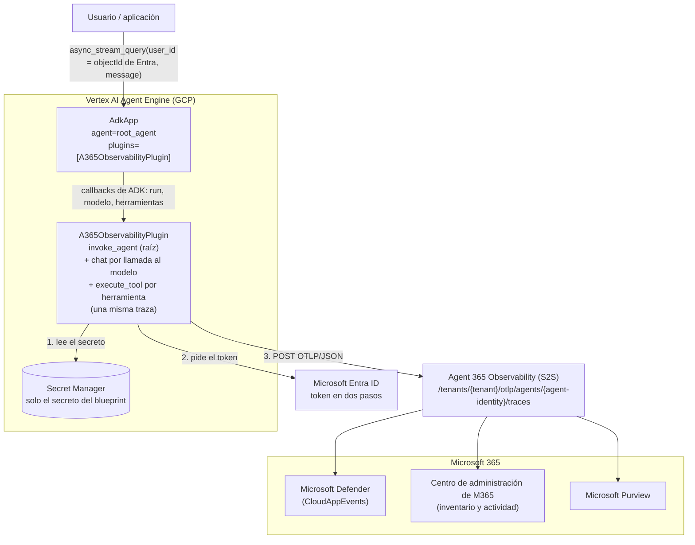

# Observabilidad en Microsoft Agent 365 para agentes de Google ADK en Vertex AI Agent Engine

Este repositorio muestra cómo hacer que un agente creado con **Google Agent Development Kit (ADK)** y
desplegado en **Vertex AI Agent Engine** (Google Cloud) envíe su actividad a **Microsoft Agent 365**,
de forma que:

- cada ejecución del agente aparece en **Microsoft Defender** (búsqueda avanzada, tabla
  `CloudAppEvents`), con el usuario que lo invocó, las preguntas, las respuestas, el modelo y cada
  herramienta usada;
- el agente aparece en el **inventario de agentes del centro de administración de Microsoft 365**
  como una instancia registrada de Agent 365, con su propia identidad de **Microsoft Entra Agent ID**.

No hace falta modificar el código del agente: un **plugin de ADK** observa cada ejecución y la envía a
Agent 365 por **OTLP/HTTP (JSON)** con autenticación **servicio a servicio (S2S)**.

Versiones probadas: google-adk 2.4.0, google-cloud-aiplatform 1.160.0, Python 3.12, Agent 365 CLI
2.0.4 y Gemini 2.5 Flash.

## Índice

1. [Arquitectura](#arquitectura)
2. [Contenido del repositorio](#contenido-del-repositorio)
3. [Requisitos](#requisitos)
4. [Guía paso a paso](#guía-paso-a-paso)
5. [Instrumentar tu propio agente](#instrumentar-tu-propio-agente)
6. [Qué se envía a Agent 365](#qué-se-envía-a-agent-365)
7. [Seguridad y datos](#seguridad-y-datos)
8. [Limpieza](#limpieza)
9. [Solución de problemas](#solución-de-problemas)
10. [Documentación oficial de Microsoft](#documentación-oficial-de-microsoft)

## Arquitectura



### Identidad y token

Agent 365 exige que coincidan tres valores: el cliente del token (`azp`), el `{agentId}` de la URL y
el atributo `gen_ai.agent.id` de los spans. Los tres son el `appId` de la **identidad de agente**.
Esa identidad no tiene credenciales propias; las tiene su **blueprint**, y el token se obtiene en dos
pasos:

1. Con el secreto del blueprint se pide un token para `api://AzureADTokenExchange/.default`,
   indicando `fmi_path = <appId de la identidad de agente>`.
2. La identidad de agente usa ese token como `client_assertion` para pedir el token de Agent 365
   (`9b975845-388f-4429-889e-eab1ef63949c/.default`).

El token resultante no lleva `roles` ni `scp`: Agent 365 lo acepta porque la identidad es una
**instancia registrada**. No hacen falta permisos de API ni consentimiento para la telemetría.

### Por qué este enfoque

| Opción | Resultado |
|---|---|
| **Plugin de ADK + identidad registrada de Entra Agent ID** (este repositorio) | Actividad en Defender y agente en el inventario, sin tocar el código del agente ni conceder permisos delegados |
| Plugin de ADK + aplicación estándar de Entra con el rol `Agent365.Observability.OtelWrite` | Actividad en Defender, pero el agente no aparece en el inventario: una aplicación estándar no es una instancia registrada. El plugin lo admite si no se define `A365_BLUEPRINT_ID` |
| Plataforma conectada Google Vertex AI (centro de administración) | Requiere una clave JSON de cuenta de servicio, importa todos los agentes del proyecto y la región, y obtiene la telemetría de Cloud Trace y de una exportación a BigQuery |
| Microsoft OpenTelemetry Distro | No instrumenta ADK automáticamente; habría que añadir los *scopes* a mano en el código del agente |

## Contenido del repositorio

| Fichero | Para qué |
|---|---|
| `agent/a365_observability.py` | **El plugin de ADK.** Convierte cada ejecución en spans de Agent 365, obtiene el token y los envía. Sin dependencias de OpenTelemetry |
| `agent/a365_entrypoint.py` | Punto de entrada de Agent Engine: `AdkApp(agent=root_agent, plugins=[plugin])` |
| `agent/sample_agent/` | Agente de ejemplo: analista de riesgo de renovación con cuatro herramientas y datos simulados |
| `agent/requirements.txt` | Versiones fijadas que se instalan en Agent Engine (y en local) |
| `config.example.json` | Plantilla de `config.json`: tenant, identidades, proyecto de GCP, secreto, nombre del despliegue |
| `a365.config.example.json` | Plantilla de `a365.config.json` para la CLI de Agent 365 |
| `new-agent-identity.ps1` | Crea la identidad de agente con la credencial del blueprint (paso 4) |
| `store-blueprint-secret.ps1` | Guarda el secreto del blueprint en Secret Manager sin mostrarlo (paso 8) |
| `send-test-span.ps1` | Prueba sin agente: obtiene el token y envía una ejecución sintética (paso 10) |
| `run_local.py` | Ejecuta el agente instrumentado en local; sin `--send` guarda las peticiones OTLP en `out/` |
| `deploy.py` | Crea o actualiza el agente en Agent Engine; sin `--apply` solo muestra el plan |
| `query.py` | Pregunta al agente desplegado |
| `gcp_auth.py` | Credenciales de GCP para los scripts: ADC o, si no están disponibles, el token de `gcloud` |

`config.json`, `a365.config.json`, `a365.generated.config.json`, `deployment.json` y `out/` son
locales y están en `.gitignore`: contienen identificadores de tu tenant y de tu proyecto, y `out/`
contiene preguntas y respuestas.

## Requisitos

**Microsoft 365 / Entra ID**

- Un tenant con **Microsoft Agent 365** habilitado (programa Frontier y una licencia que lo incluya,
  por ejemplo Microsoft 365 E7).
- Una cuenta con rol **Administrador global** para crear el blueprint y registrar el agente.
- Acceso a **Microsoft Defender** (búsqueda avanzada) para comprobar la actividad.

**Herramientas locales** (los comandos de esta guía son de PowerShell 7 en Windows)

- [.NET SDK 10](https://dotnet.microsoft.com/download) y la CLI de Agent 365
- [Azure CLI](https://learn.microsoft.com/cli/azure/install-azure-cli)
- Módulos de PowerShell `Microsoft.Graph.Authentication` y `Microsoft.Graph.Applications` (misma versión)
- [Google Cloud CLI](https://cloud.google.com/sdk/docs/install) (`gcloud`)
- Python 3.12

**Google Cloud**

- Un proyecto con facturación y permisos para habilitar API, crear cuentas de servicio, secretos y
  agentes de [Vertex AI Agent Engine](https://cloud.google.com/vertex-ai/generative-ai/docs/agent-engine/overview).

## Guía paso a paso

En los comandos, sustituye lo que va entre `< >`. Elige antes el nombre del agente; en los ejemplos
es `a365-renewal-risk-sample`.

### Paso 0. Preparar el repositorio

```powershell
git clone https://github.com/<usuario>/agent365-vertex-adk-observability.git
cd agent365-vertex-adk-observability

python -m venv .venv
.\.venv\Scripts\Activate.ps1
pip install -r agent/requirements.txt

Copy-Item config.example.json config.json
Copy-Item a365.config.example.json a365.config.json
```

### Paso 1. Instalar las herramientas de Microsoft e iniciar sesión

```powershell
dotnet tool install -g Microsoft.Agents.A365.DevTools.Cli
a365 --version

Install-PSResource Microsoft.Graph.Authentication, Microsoft.Graph.Applications -Scope CurrentUser
Get-Module -ListAvailable Microsoft.Graph.Authentication, Microsoft.Graph.Applications

az login --tenant <tenant-id>      # con el administrador global
```

Los dos módulos de Microsoft Graph deben tener la misma versión.

### Paso 2. Configurar la CLI de Agent 365

Edita `a365.config.json`:

| Campo | Valor |
|---|---|
| `tenantId` | Id. del tenant |
| `clientAppId` | Aplicación cliente que usa la CLI (ver abajo) |
| `agentIdentityDisplayName` | Nombre de la identidad, p. ej. `a365-renewal-risk-sample Identity` |
| `agentBlueprintDisplayName` | Nombre del blueprint, p. ej. `a365-renewal-risk-sample Blueprint` |
| `aiTeammate` / `useBlueprint` | `false` / `true` (agente con blueprint, no *AI Teammate*) |

Comprueba los requisitos (no crea nada):

```powershell
a365 setup requirements
```

La línea `Client App Configuration (<id>)` muestra la aplicación cliente; pon ese id en `clientAppId`.
Si no existe ninguna, el comando la pide y un administrador global puede crearla respondiendo `C`.

### Paso 3. Crear el blueprint

Simula y después ejecuta:

```powershell
a365 setup all --authmode s2s --dry-run
a365 setup all --authmode s2s
```

`--authmode s2s` indica que el agente se autentica como servicio, sin usuario. El comando:

1. crea el **blueprint** (aplicación de Entra), su entidad de servicio y un **secreto de cliente**,
   que guarda cifrado para tu usuario de Windows en esta carpeta;
2. configura los **permisos heredables** del blueprint;
3. abre el navegador para el **consentimiento de administrador de permisos delegados** (Microsoft
   Graph, Agent 365 Tools y Power Platform API);
4. crea la **identidad de agente** y la **registra** en Agent 365.

Los permisos delegados del punto 3 sirven para que el agente actúe en nombre de usuarios (correo,
Teams, herramientas de Work IQ). **La telemetría no los necesita.** Elige una opción:

- **Mínimo privilegio (recomendada).** No aceptes el consentimiento: deja que expire (180 s) y
  responde `N` a `Add these permissions to the blueprint programmatically?`. La CLI se detiene con el
  blueprint y su secreto ya creados. Continúa en el paso 4.
- **Aceptar el consentimiento.** La CLI crea y registra la identidad. Continúa en el paso 6.

### Paso 4. Crear la identidad de agente

```powershell
.\new-agent-identity.ps1                          # patrocinador: el usuario de az
# .\new-agent-identity.ps1 -SponsorUpn alguien@contoso.com
```

El script lee el blueprint de `a365.generated.config.json`, obtiene un token de aplicación del propio
blueprint (que incluye `AgentIdentity.CreateAsManager`) y crea la identidad con
`POST https://graph.microsoft.com/v1.0/servicePrincipals/microsoft.graph.agentIdentity`, con el nombre
de `agentIdentityDisplayName` y un **patrocinador**. Muestra el `appId` de la identidad. Si ya existe,
no hace nada.

### Paso 5. Registrar la identidad en Agent 365

```powershell
a365 setup all --authmode s2s --agent-registration-only
```

Busca la identidad por su nombre y la registra:

```text
Found agent identity (ID: <identity-appId>). Using it for registration.
Agent registered (ID: <registration-id>)
Setup completed successfully
```

### Paso 6. Anotar los identificadores

Completa en `config.json`:

| Campo | Valor |
|---|---|
| `tenantId` | Id. del tenant |
| `agentAppId` | `appId` de la **identidad de agente** |
| `agentBlueprintId` | `agentBlueprintId` de `a365.generated.config.json` |
| `agentName`, `agentDescription` | Nombre y descripción que verás en Defender y en el inventario |
| `testUserId` | `objectId` de Entra del usuario de pruebas (`az ad user show --id <upn> --query id -o tsv`) |

### Paso 7. Preparar Google Cloud

```powershell
$PROJECT = "<gcp-project-id>"; $REGION = "us-central1"; $SA = "a365-adk-agent"
$SA_EMAIL = "$SA@$PROJECT.iam.gserviceaccount.com"

gcloud services enable aiplatform.googleapis.com secretmanager.googleapis.com iam.googleapis.com `
    logging.googleapis.com --project $PROJECT

# Identidad con la que se ejecuta el agente en Agent Engine
gcloud iam service-accounts create $SA --project $PROJECT --display-name "ADK agent with Agent 365 observability"
foreach ($role in 'roles/aiplatform.user', 'roles/logging.logWriter') {
    gcloud projects add-iam-policy-binding $PROJECT --member "serviceAccount:$SA_EMAIL" --role $role --condition=None | Out-Null
}

# Permiso para desplegar con esa cuenta de servicio (iam.serviceAccounts.actAs)
gcloud iam service-accounts add-iam-policy-binding $SA_EMAIL --project $PROJECT `
    --member "user:<tu-cuenta-de-gcp>" --role roles/iam.serviceAccountUser
```

| Rol | Para qué |
|---|---|
| `roles/aiplatform.user` | Llamar a Gemini en Vertex AI |
| `roles/logging.logWriter` | Escribir en Cloud Logging, donde el plugin deja el resultado de cada envío |
| `roles/secretmanager.secretAccessor` (solo sobre el secreto) | Leer el secreto del blueprint; lo concede `deploy.py` en el paso 12 |
| `roles/cloudtrace.agent`, `roles/monitoring.metricWriter` (opcionales) | Telemetría propia de Agent Engine en Cloud Trace y Cloud Monitoring |

Completa en `config.json`: `gcpProject`, `gcpRegion`, `serviceAccount` (`$SA_EMAIL`), `displayName`
(nombre del agente en Agent Engine) y `secretName` (p. ej. `a365-blueprint-secret`).

### Paso 8. Guardar el secreto del blueprint en Secret Manager

```powershell
.\store-blueprint-secret.ps1
```

Lee el secreto con `a365 setup blueprint --show-secret` (por eso se ejecuta en esta carpeta y con el
mismo usuario de Windows que el paso 3), crea el secreto en Secret Manager si no existe y añade una
versión. El valor no se muestra ni queda en disco.

### Paso 9. Iniciar sesión en Google Cloud

```powershell
gcloud auth login
gcloud auth application-default login
gcloud config set project <gcp-project-id>
```

Los scripts usan las *Application Default Credentials* (ADC); si no están disponibles, usan el token
de la cuenta activa de `gcloud` y lo indican con `ADC unavailable ...`.

### Paso 10. Probar el envío sin agente

```powershell
.\send-test-span.ps1
```

Obtiene el token en dos pasos, muestra sus *claims* (nunca el token) y envía una ejecución sintética
(`invoke_agent` + `chat` + `execute_tool`):

```text
Token: aud=9b975845-388f-4429-889e-eab1ef63949c azp=<identity-appId> tid=<tenant-id> roles= scp=
Eligibility: HTTP 403
POST traces: HTTP 200  conversationId=<guid>  traceId=<hex>
partialSuccess: rejectedSpans=0
  invoke_agent  flashpoint  sent
  ...
```

Comprueba que:

- `azp` es la identidad de agente y `roles` y `scp` están vacíos;
- la respuesta es HTTP 200 con `rejectedSpans=0`;
- cada span aparece como `sent`.

La línea `Eligibility` da 403 con este tipo de token; no afecta al envío.

### Paso 11. Probar el agente en local

```powershell
python run_local.py                                       # no envía: guarda el OTLP en out/
python run_local.py "Assess renewal risk for Fabrikam" --send
```

Usa el mismo punto de entrada que Agent Engine y llama a Gemini en tu proyecto:

```text
  -> tool get_account
  -> tool list_incidents
  -> tool get_usage_trend
  -> tool get_contract_terms
Renewal Risk: **High** ...
[dry run] 8 spans -> otlp-<fecha>-1.json: chat, chat, chat, execute_tool:get_account, ..., invoke_agent
```

El JSON de `out/` es exactamente lo que se enviaría.

### Paso 12. Desplegar en Agent Engine

```powershell
python deploy.py            # plan, sin cambios
python deploy.py --apply    # permiso sobre el secreto + creación (o actualización) del agente
```

El plan muestra proyecto, nombre, cuenta de servicio, el permiso sobre el secreto y las variables de
entorno (`A365_*`). Con `--apply`:

1. concede a la cuenta de servicio `roles/secretmanager.secretAccessor` **solo sobre el secreto**;
2. sube el código (`sample_agent`, plugin, punto de entrada, `requirements.txt`) y crea el agente
   (0–1 instancias, 1 CPU, 2 GiB), o lo **actualiza** si ya lo desplegó este script;
3. guarda el recurso en `deployment.json`.

La creación tarda varios minutos.

### Paso 13. Usar el agente desplegado

```powershell
python query.py "Assess renewal risk for Contoso"
python query.py "Compare renewal risk between Contoso and Northwind Traders"
```

Pasa como `user_id` el `objectId` de Entra de quien pregunta (por defecto `testUserId`): así Defender
atribuye la ejecución a ese usuario.

Comprueba el envío en Cloud Logging:

```powershell
$ENGINE_ID = (Get-Content deployment.json | ConvertFrom-Json).resource.Split('/')[-1]
gcloud logging read "resource.type=`"aiplatform.googleapis.com/ReasoningEngine`" AND resource.labels.reasoning_engine_id=`"$ENGINE_ID`" AND textPayload:`"Agent 365`"" `
    --project <gcp-project-id> --limit 5 --format "value(timestamp,textPayload)"
```

Cada ejecución deja una línea como:

```text
INFO a365_observability: Agent 365 export HTTP 200 rejectedSpans=0 invoke_agent=sent chat=sent execute_tool:get_account=sent ...
```

### Paso 14. Verificar en Defender

La actividad tarda entre 5 y 30 minutos en aparecer. En **security.microsoft.com → Investigación y
respuesta → Búsqueda → Búsqueda avanzada**:

```kusto
let agentIdToFind = "<identity-appId>";
CloudAppEvents
| where Timestamp > ago(1d)
| where ActionType in ("InvokeAgent", "InferenceCall", "ExecuteToolBySDK", "ExecuteToolByGateway", "ExecuteToolByMCPServer")
| extend resData = parse_json(tostring(RawEventData))
| where resData.AgentId == agentIdToFind or resData.TargetAgentId == agentIdToFind or resData.PlatformTargetAgentId == agentIdToFind
| project Timestamp, ActionType, AccountObjectId, resData
| order by Timestamp desc
```

Resumen por tipo de evento:

```kusto
let agentIdToFind = "<identity-appId>";
CloudAppEvents
| where Timestamp > ago(1d)
| where ActionType in ("InvokeAgent", "InferenceCall", "ExecuteToolBySDK")
| extend resData = parse_json(tostring(RawEventData))
| where resData.AgentId == agentIdToFind or resData.TargetAgentId == agentIdToFind
| summarize Eventos = count() by ActionType, bin(Timestamp, 10m)
| order by Timestamp asc
```

Una ejecución concreta (el `conversationId` es el id de sesión de Agent Engine):

```kusto
CloudAppEvents
| where Timestamp > ago(1d)
| where tostring(RawEventData) has "<conversationId>"
| project Timestamp, ActionType, AccountObjectId, RawEventData
| order by Timestamp asc
```

Cada ejecución produce un `InvokeAgent`, un `InferenceCall` por llamada al modelo y un
`ExecuteToolBySDK` por herramienta. El usuario (`AccountObjectId`) figura en el evento `InvokeAgent`.

### Paso 15. Verificar el inventario

En **admin.microsoft.com → Agentes → Todos los agentes → Registro**, busca el agente por nombre o por
**Id. de agente** (`<identity-appId>`). Puede tardar más en aparecer que la actividad en Defender.

## Instrumentar tu propio agente

1. Copia `agent/a365_observability.py` junto a tu agente.
2. En el punto de entrada, registra el plugin:

   ```python
   from vertexai.agent_engines import AdkApp
   from a365_observability import A365ObservabilityPlugin
   from my_agent.agent import root_agent

   app = AdkApp(agent=root_agent, plugins=[A365ObservabilityPlugin.from_env()])
   ```

   Con `deploy.py`: pon tu paquete en `agent/<paquete>/`, cambia el `import` de
   `agent/a365_entrypoint.py` y `AGENT_PACKAGE` en `deploy.py`, y añade tus dependencias a
   `agent/requirements.txt`. Las variables que necesite tu agente van en `agentEnv` de `config.json`.
3. Variables de entorno del plugin (`deploy.py` y `run_local.py` las rellenan desde `config.json`):

   | Variable | Obligatoria | Valor |
   |---|---|---|
   | `A365_TENANT_ID` | Sí | Tenant |
   | `A365_AGENT_APP_ID` | Sí | `appId` de la identidad de agente |
   | `A365_BLUEPRINT_ID` | Sí, con Agent ID | `appId` del blueprint (activa el token en dos pasos) |
   | `A365_AGENT_NAME` | Sí | Nombre visible |
   | `A365_SECRET_NAME` | Sí | Secreto de Secret Manager con la credencial |
   | `A365_SECRET_PROJECT` | No | Proyecto del secreto (por defecto, el del agente) |
   | `A365_AGENT_DESCRIPTION`, `A365_CHANNEL` (`web`), `A365_SERVICE_NAME` | No | Descripción, canal y `service.name` |
   | `A365_DEFAULT_USER_ID` | No | `user.id` cuando el `user_id` de la sesión no es un objectId |
   | `A365_DRY_RUN=1` | No | Construye y registra los spans, pero no envía nada |

4. Llama al agente con `user_id` = **objectId de Entra** del usuario. Opcionalmente, guarda en el
   estado de la sesión `a365_user_email`, `a365_user_name` y `a365_client_ip`.

### Cómo funciona el plugin

| Callback de ADK | Qué hace |
|---|---|
| `before_run_callback` | Abre el span raíz `invoke_agent` con los atributos comunes |
| `on_event_callback` | Recoge el texto final de la respuesta |
| `before_model_callback` / `after_model_callback` | Abre y cierra un span `chat` por llamada al modelo (tokens, motivo de fin) |
| `before_tool_callback` / `after_tool_callback` | Abre y cierra un span `execute_tool` (argumentos y resultado; tipo `function` o `MCP Server` con su host) |
| `on_model_error_callback` / `on_tool_error_callback` | Marca el error y cierra la ejecución |
| `after_run_callback` | Envía la ejecución completa, en lotes de menos de 900 KB |

- Es de **mejor esfuerzo**: cualquier fallo de telemetría se registra y nunca llega al agente.
- No usa el SDK de OpenTelemetry (construye el OTLP/JSON directamente), así que no hay conflictos de
  versiones con ADK.
- Recorta los mensajes a 32 000 caracteres y los argumentos y resultados de herramientas a 16 000,
  manteniendo JSON válido.

## Qué se envía a Agent 365

| Span | Evento en Defender | Atributos principales |
|---|---|---|
| `invoke_agent <nombre>` (raíz) | `InvokeAgent` | `gen_ai.input.messages`, `gen_ai.output.messages`, `gen_ai.request.model`, `gen_ai.execution.type=HumanToAgent` |
| `chat <modelo>` | `InferenceCall` | `gen_ai.request.model`, `gen_ai.provider.name=gcp.vertex_ai`, mensajes, `gen_ai.usage.input_tokens`/`output_tokens` |
| `execute_tool <herramienta>` | `ExecuteToolBySDK` | `gen_ai.tool.name`, `gen_ai.tool.type`, `gen_ai.tool.call.id`, `gen_ai.tool.call.arguments`, `gen_ai.tool.call.result` |

Comunes a todos: `gen_ai.agent.id`, `gen_ai.agent.name`, `microsoft.a365.agent.blueprint.id`,
`microsoft.tenant.id`, `user.id`, `gen_ai.conversation.id` y `microsoft.session.id` (id de sesión de
Agent Engine), `microsoft.channel.name`, `server.address`, `service.name`.

Las herramientas de servidores MCP también se registran como `ExecuteToolBySDK`.

## Seguridad y datos

- El único secreto es el del blueprint: vive en **Secret Manager** y solo la cuenta de servicio del
  agente puede leerlo. Los scripts nunca lo muestran. Renuévalo antes de que caduque y vuelve a
  ejecutar `store-blueprint-secret.ps1`.
- No se conceden permisos delegados ni el rol `OtelWrite`: la instancia registrada basta para enviar
  telemetría.
- Los spans incluyen **preguntas, respuestas y resultados de herramientas**, que quedan en Defender y
  Purview. Si contienen datos sensibles, recórtalos o enmascáralos en el plugin (`_messages_json`,
  `_clip_json`).
- `out/`, `config.json` y los ficheros de la CLI de Agent 365 contienen identificadores y datos de
  prueba: no los subas al repositorio (ya están en `.gitignore`).

## Limpieza

```powershell
# Agent Engine
$RESOURCE = (Get-Content deployment.json | ConvertFrom-Json).resource
Invoke-RestMethod -Method Delete -Headers @{ Authorization = "Bearer $(gcloud auth print-access-token)" } `
    -Uri "https://<region>-aiplatform.googleapis.com/v1/$RESOURCE"

# Secreto y cuenta de servicio
gcloud secrets delete <secretName> --project <gcp-project-id>
gcloud iam service-accounts delete <serviceAccount> --project <gcp-project-id>

# Registro, identidad y blueprint de Entra (desde esta carpeta)
a365 cleanup
```

## Solución de problemas

**Instalación y registro**

| Síntoma | Causa | Solución |
|---|---|---|
| `Save-Module`/`Install-Module`: `Unable to find repository 'PSGallery'` | PowerShellGet sin el repositorio PSGallery registrado | Usa `Install-PSResource` (PSResourceGet), como en el paso 1 |
| Descarga de módulos con error TLS (`cdn.powershellgallery.com`) | La red bloquea la CDN de PowerShell Gallery | Instala desde un repositorio interno de tu organización o copia las carpetas de los módulos desde otro equipo a `Documents\PowerShell\Modules` |
| `a365 setup requirements`: aviso `Frontier Preview Program - Tenant enrollment cannot be verified automatically` | La CLI no puede comprobar la inscripción del tenant | Ninguna, si el tenant tiene Agent 365 habilitado |
| `a365 setup all` termina con `Setup cancelled` tras el consentimiento | No se aceptaron los permisos delegados | Es lo esperado con la opción de mínimo privilegio: pasos 4 y 5 |
| `--agent-registration-only`: `Agent identity ID is not set in config` | La identidad de agente no existe todavía. Su `--dry-run` indica que la crearía, pero solo la busca | Ejecuta `new-agent-identity.ps1` y repite |
| `store-blueprint-secret.ps1` o `new-agent-identity.ps1`: `Could not read the blueprint secret` | Se ejecutan en otra carpeta o con otro usuario de Windows que el paso 3 | Ejecútalos en la carpeta y con el usuario del paso 3, o crea un secreto nuevo para el blueprint |

**Token y envío a Agent 365**

| Síntoma | Causa | Solución |
|---|---|---|
| Token, primer paso: HTTP 400 | `client_id` no es el blueprint, o falta o es incorrecto `fmi_path` | `client_id` = blueprint, `fmi_path` = `appId` de la identidad de agente |
| `AADSTS7000215` (secreto no válido) | El secreto de Secret Manager no es el del blueprint o ha caducado | Vuelve a ejecutar `store-blueprint-secret.ps1` |
| `Eligibility: HTTP 403` en `send-test-span.ps1` | La consulta de elegibilidad pide el rol `OtelWrite`, que una instancia registrada no tiene | Ninguna: no afecta al envío |
| POST traces: 403 `insufficient_scope` | La identidad no está registrada (o es una aplicación estándar sin el rol `OtelWrite`) | `a365 setup all --authmode s2s --agent-registration-only` |
| HTTP 200 pero `rejectedSpans` > 0 | Atributos obligatorios ausentes o no válidos | Revisa `partialSuccess.errorMessage` y el OTLP de `out/` (paso 11) |
| HTTP 200 y spans `sent`, pero nada en Defender | La ingesta tarda | Espera hasta 30 minutos |
| Actividad en Defender pero el agente no está en el inventario | Se usa una aplicación estándar de Entra en vez de una identidad registrada | Pasos 3 a 6 |
| El usuario no aparece en `InferenceCall` ni en `ExecuteToolBySDK` | Defender solo resuelve el usuario en `InvokeAgent` | Ninguna; filtra por `InvokeAgent` para ver quién ejecutó el agente |

**Google Cloud**

| Síntoma | Causa | Solución |
|---|---|---|
| `RefreshError: Reauthentication is needed` | Las ADC han caducado | `gcloud auth application-default login`; mientras tanto, los scripts usan el token de `gcloud` (válido una hora) |
| `deploy.py`: falta el permiso `iam.serviceAccounts.actAs` | Tu usuario no tiene `roles/iam.serviceAccountUser` sobre la cuenta de servicio | Paso 7 |
| `deploy.py`: `already exists and was not deployed from here` | Ya hay otro agente con ese `displayName` | Cambia `displayName` en `config.json` |
| `deploy.py`: `Secret ... does not exist` | No se ha guardado el secreto | Paso 8 |
| Logs del agente: `Failed to export span/metrics batch code: 403` | Telemetría propia de Agent Engine sin roles de Cloud Trace o Cloud Monitoring | Ignóralo u otorga los roles opcionales del paso 7; no afecta a Agent 365 |
| Logs del agente: `Agent 365 export HTTP 4xx` | Error en el token o en el envío | Reproduce con `send-test-span.ps1` y consulta las tablas anteriores |

## Documentación oficial de Microsoft

**Microsoft Agent 365**

- [Microsoft Agent 365 overview](https://learn.microsoft.com/microsoft-agent-365/overview)
- [Quickstart: Connect an existing agent to Agent 365](https://learn.microsoft.com/microsoft-agent-365/developer/get-started)
- [Understand the total agent count](https://learn.microsoft.com/microsoft-agent-365/admin/total-agent-count) (qué agentes aparecen en el inventario)
- [Connect Google Vertex AI to Microsoft Agent 365](https://learn.microsoft.com/microsoft-agent-365/admin/connected-platforms-google-vertex-ai) (plataforma conectada)

**Observabilidad**

- [Integrate agent observability using direct OTel](https://learn.microsoft.com/microsoft-agent-365/developer/direct-open-telemetry-integration)
- [Agent 365 observability data model and concepts](https://learn.microsoft.com/microsoft-agent-365/developer/observability-concepts)
- [Agent 365 observability attribute reference](https://learn.microsoft.com/microsoft-agent-365/developer/observability-attribute-reference)
- [Troubleshoot direct OTel observability](https://learn.microsoft.com/microsoft-agent-365/developer/direct-open-telemetry-troubleshooting)

**Identidad y registro**

- [Agent 365 identity](https://learn.microsoft.com/microsoft-agent-365/developer/identity)
- [Set up the agent blueprint (registration)](https://learn.microsoft.com/microsoft-agent-365/developer/registration)
- [What are agent identities? (Microsoft Entra Agent ID)](https://learn.microsoft.com/entra/agent-id/what-are-agent-identities)
- [Agent identity blueprints](https://learn.microsoft.com/entra/agent-id/agent-blueprint)
- [Configure inheritable permissions for agent identity blueprints](https://learn.microsoft.com/entra/agent-id/configure-inheritable-permissions-blueprints)
- [Microsoft Graph: Create agentIdentity](https://learn.microsoft.com/graph/api/agentidentity-post)

**CLI de Agent 365**

- [Install and use the Agent 365 CLI](https://learn.microsoft.com/microsoft-agent-365/developer/agent-365-cli)
- [`a365 setup` command reference](https://learn.microsoft.com/microsoft-agent-365/developer/reference/cli/setup)
- [`a365 cleanup` command reference](https://learn.microsoft.com/microsoft-agent-365/developer/reference/cli/cleanup)

**Microsoft Defender**

- [Advanced hunting overview](https://learn.microsoft.com/defender-xdr/advanced-hunting-overview)
- [CloudAppEvents table](https://learn.microsoft.com/defender-xdr/advanced-hunting-cloudappevents-table)

**Herramientas**

- [Install the Microsoft Graph PowerShell SDK](https://learn.microsoft.com/powershell/microsoftgraph/installation)
- [Install-PSResource](https://learn.microsoft.com/powershell/module/microsoft.powershell.psresourceget/install-psresource)
- [Install the Azure CLI](https://learn.microsoft.com/cli/azure/install-azure-cli)
